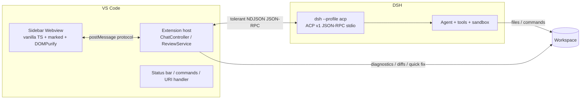

# Architecture

> Unofficial community VS Code client for [DeepSeek Harness](https://github.com/deepseek-ai/deepseek-harness). It talks to the official **ACP (Agent Client Protocol)** automation surface over stdio; it never patches DSH.

## Layers

| Layer | Directory | Responsibility |
|---|---|---|
| ACP transport | `src/acp/transport.ts` | Spawn `dsh --profile acp`, tolerant NDJSON framing (skips non-protocol stdout lines), process lifecycle |
| JSON-RPC | `src/acp/jsonrpc.ts` | Minimal JSON-RPC 2.0 peer: requests, notifications, server requests, errors, timeouts |
| Protocol vocabulary | `src/acp/protocol.ts` | ACP v1 subset (`initialize`, `session/*`, permission requests, updates) + config-option normalization |
| Runtime | `src/acp/runtime.ts` | Launcher discovery (`dsh` on PATH → desktop CLI → npx), initialize handshake, capability state machine |
| Compatibility | `src/acp/compat.ts` | ACP profile discovery, probes (version / help / initialize), profile self-repair, `compat` CLI |
| Session | `src/session/` | `session/new|list|resume|close`, prompt single-flight queue, update → transcript events, local transcript persistence |
| Context | `src/context/` | Focused-editor auto context (file or selection + surrounding lines); `media.ts` holds the pure image/audio-video detection, MIME map and size cap shared by extension, webview and prompt builder |
| Modes | `src/mode/` | Client-side plan / goal guidance and the plan-mode permission gate (ACP exposes no session modes) |
| Model | `src/model/` | Legacy model-id filtering/aliases, read user `agent-default-model` preference from DSH profiles |
| Review | `src/review/` | Prompts + findings JSON contract, findings parsing, diagnostics, git diff, turn-diff collection, change tracking, Quick Fix, undo-turn snapshots |
| UI | `src/ui/` | Webview provider, permission broker (sidebar card ↔ modal fallback), status bar, diagnose report |
| Front end | `src/webview/` | Chat rendering, thought chain, composer, findings panel, markdown sanitization |

## ACP surface used

- Client → agent: `initialize`, `session/new`, `session/list`, `session/resume`, `session/close`, `session/set_config_option`, `session/prompt`, notification `session/cancel`.
- Agent → client: notification `session/update` (message/thought/tool/usage/config), request `session/request_permission` (answered with an advertised `optionId` or cancelled).

Deliberately **no** ACP SDK dependency: DSH occasionally prints log lines to stdout and may add unknown update kinds; a hand-written tolerant client keeps the extension working across DSH updates. `src/acp/protocol.ts` is the single place to adapt if the wire protocol changes.

## Data flow

1. Webview posts `send` / `reviewFile` / `setConfig` / `setMode` / `setAutoReview` / `setPermissionMode` / `setFontScale` / `permissionResponse` / `fixFinding` … through `src/ui/protocol.ts`.
2. `ChatController` (extension) prepends the active mode's guidance, collects auto context, builds ACP `ContentBlock[]`, ensures runtime/session and sends `session/prompt`. Image refs (`kind:'image'`) are read with `vscode.workspace.fs`, capped at 5MB and embedded as base64 `image` blocks (guarded by the runtime's `imagePrompts` capability); audio/video refs are skipped with a toast.
3. On activation the controller schedules a background `ensureReady()` (~400ms, `deepseekHarness.autoStartRuntime`, single-flight) so the runtime starts even before the sidebar is opened.
4. `session/update` notifications are projected into sidebar transcript entries; permission requests are routed to the sidebar card when visible, otherwise to a VS Code modal. In plan mode the controller answers write/command requests with the agent's `reject_*` option instead of asking.
5. Review commands parse the agent's findings JSON into VS Code diagnostics; the same findings feed the CodeAction provider (Quick Fix).
6. Before a turn that may write files, the change tracker records a `git stash create` snapshot + untracked-file snapshot; after the turn it records changed paths and hashes, enabling hash-guarded "undo turn".
7. When auto review is on, the controller collects the turn's diff (`review.collectTurnDiff`, including embedded content of new untracked files) and sends one review prompt with `userEntry: 'none'` so it does not add a user bubble; the review turn never touches the undo baseline.
8. While a turn is running, `ChatController.send()` stores the message in `pending` (`src/session/pending.ts`) instead of calling `runPrompt`; when the session reports idle (`setBusy(false)`) a single-flight drain sends `steer` items before `queue` items, one by one. `steer` never cancels the in-flight prompt — ACP allows one prompt per session, so it only reorders the local queue.
9. The user transcript entry is a display decision: review/fix prompts use their short label, chat uses only the typed text, auto review uses no entry at all (`PromptDisplayOptions`).

## Security model

- Local only: the extension spawns `dsh`; no network service and no telemetry.
- Webview: strict CSP (`default-src 'none'`), nonce scripts, no remote resources, DOMPurify-sanitized Markdown.
- Permissions: `deepseekHarness.permissionMode` maps to `DSH_PERMISSION_MODE`; `read-only` asks before every write/command.
- Commands and git calls use argument arrays (`shell: false`) except the Windows `.cmd` launcher, whose token is quoted and validated.

## Testing strategy

| Layer | Tests |
|---|---|
| Transport / JSON-RPC / protocol | `test/transport.test.ts`, `test/jsonrpc.test.ts`, `test/protocol.test.ts` |
| Runtime compatibility | `test/compat.test.ts` |
| Session manager | `test/session.test.ts` (in-memory fake peer; includes the user-entry display policy) |
| Review / findings / prompts / git | `test/review-*.test.ts` (turn-diff partitioning in `test/review-turn-diff.test.ts`) |
| Modes | `test/modes.test.ts` (prompt sections + plan-mode permission matrix) |
| Quick Fix / revert | `test/quickfix-*.test.ts`, `test/review-revert*.test.ts` |
| UI pure logic | `test/webview-thought.test.ts`, `test/ui-polish.test.ts` (incl. findings-JSON stripping), `test/ui-diagnose.test.ts` |
| Real DSH | `npm run compat`, `npm run smoke`, `npm run smoke:ext`, `SMOKE_STRICT=1 npm run smoke:ext` |
